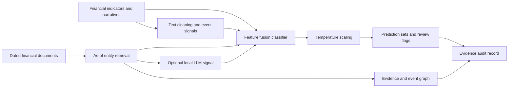
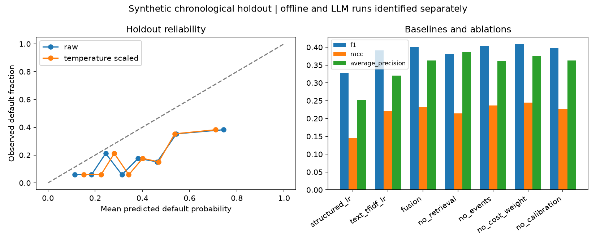
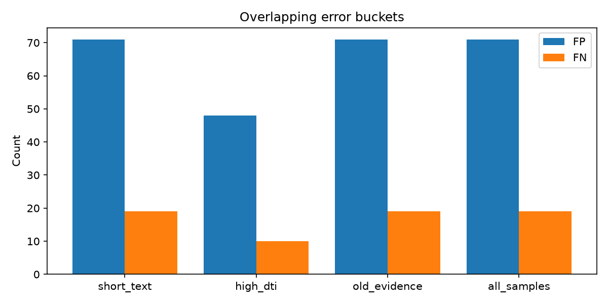

# FinTextRiskProject

**Financial risk assessment through text mining, evidence retrieval, and structured-feature fusion.**

FinTextRiskProject converts financial narratives and dated source documents into traceable risk signals, combines those signals with financial indicators, and produces default-risk estimates, uncertainty sets, and evidence-backed audit records. It includes a local LLM connector for retrieval-grounded signal extraction and an offline pipeline for reproducible model evaluation.

## Architecture



## Capabilities

- **Text mining:** financial event indicators, sentiment signals, uncertainty, entropy, and basic contact-detail redaction.
- **Evidence retrieval:** entity-specific TF-IDF similarity, publication/availability cutoffs, content deduplication, source credibility, and exponential time decay.
- **Knowledge representation:** entity-document-event graph with source identifiers and timestamps.
- **Risk modeling:** financial indicators, narrative features, and retrieved evidence signals in a cost-sensitive fusion classifier.
- **LLM integration:** local Ollama JSON extraction, evidence-ID validation, input hashes, model identity, and prompt-version tracking. Optional LLM signals become a trained feature in the fusion model.
- **Model governance:** chronological partitions with label-maturity purging, calibration, classification prediction sets, integrated-gradient attribution, overlapping error buckets, a DTI-shift stress test, and an income slice.

## Installation

Python 3.11 or newer:

```sh
python -m venv .venv
# Windows: .venv\Scripts\activate
# macOS/Linux: source .venv/bin/activate
python -m pip install -e .
```

## Train and score

```sh
python -m fintext_risk.cli train --rows 1800 --seed 19 --output reports
python -m fintext_risk.cli score
python -m unittest discover -s tests -v
```

Training generates a model bundle, assessment input CSV, metrics, charts, an evidence subgraph, and audit examples. Scoring produces `assessments.json` with default probabilities, review flags, prediction sets, abstentions, evidence IDs, and the active backend. Generated model and CSV artifacts stay local; load only trusted joblib model bundles.

## Use a local LLM

Install and run Ollama separately, and load a model suitable for your machine. The project does not download models or call paid APIs automatically.

```sh
fintext-risk llm-enrich --model-name YOUR_LOCAL_MODEL --rows 1800 --seed 19 --output llm_signals.jsonl
fintext-risk train --rows 1800 --seed 19 --llm-signals llm_signals.jsonl --output llm_reports
```

Use the same row count and seed for extraction and training. Each record is checked against the application hash and available evidence IDs. LLM-enabled scoring requires a matching subset of signal records for the applications being scored. For example, using the generated input CSV:

```sh
fintext-risk score --model llm_reports/risk_model.joblib --applications llm_reports/applications.csv --llm-signals matching_signals.jsonl --output llm_assessments.json
```

A local LLM run can be materially slower than the offline path. Plan extraction volume and model resources before running the complete dataset.

## Data and evaluation

The reproducible dataset contains **1,800 synthetic assessments and 7,200 timestamped source documents**. Labels mature 90 days after assessment, and records with unavailable outcomes are purged from each development partition. No private financial data or manuscript files are distributed.

The published run uses **offline text/retrieval fusion**. Its primary holdout metrics are F1 **0.400**, MCC **0.232**, average precision **0.363**, and ROC-AUC **0.686**. These are newly measured results on the generated dataset, separate from the paper's reported results.

[Full results](reports/RESULTS.md) · [Metrics](reports/metrics.json) · [Audit examples](reports/audit_examples.json) · [Evidence graph](reports/evidence_graph.json)





## Research mapping

The design follows the five-layer structure of *Construction of Financial Risk Assessment Model Based on Text Mining and LLM Architecture*: data, knowledge, models, services, and governance. [Paper mapping](docs/PAPER_MAPPING.md) identifies the implementation used for every major module, including differences from pretrained encoders, CRF tagging, FinBERT, and the paper's experiment setup.

The offline backend uses TF-IDF, dictionary-based event signals, and a linear fusion classifier. Local LLM extraction and optional feature fusion are implemented, while live model execution is recorded separately. LLM connector tests use mocked responses; no live LLM result is included in the published metrics.

## Evaluation scope

Temperature scaling and coverage are measured rather than assumed to improve. On this run, fusion does not lead every ablation, calibration does not reduce holdout ECE, and empirical label-set coverage is 88.9% against a 90% nominal target. Prediction sets describe possible labels, not confidence intervals for an individual's probability of default.

Further work with representative data is required for real financial use: dataset permissions, temporal generalization, probability calibration, model pretraining chronology, fairness, security, and operational governance. Evidence validation checks available source IDs; it does not prove that an LLM's explanation is faithful. Contact-detail filtering is a limited redaction rule, not a comprehensive privacy audit.

## Repository layout

```text
fintext_risk/evidence.py     Text signals, as-of retrieval and event graph
fintext_risk/data.py         Synthetic records and purged chronological partitions
fintext_risk/modeling.py     Feature fusion, LLM-signal alignment and attribution
fintext_risk/governance.py   Temperature fitting, prediction sets, ECE and PSI
fintext_risk/llm.py          Local model connector and response validation
fintext_risk/cli.py          Training, reporting, scoring and LLM extraction
tests/                      Temporal, evidence, statistical and connector tests
reports/                    Executed metrics, charts, audits and evidence graph
docs/                       Methodology and paper-to-code mapping
```
